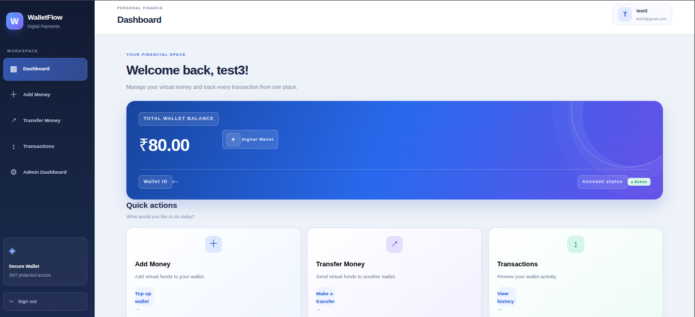
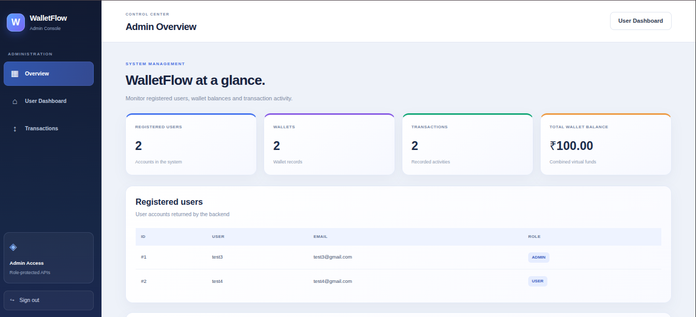
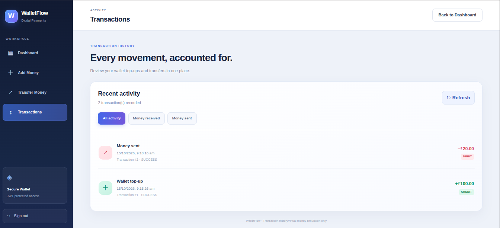
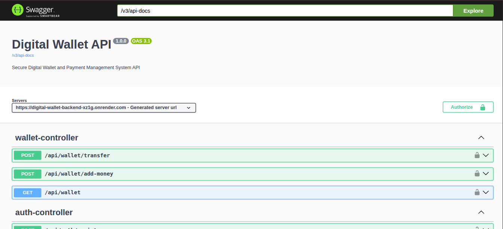

# Digital Wallet — Frontend

A responsive React-based frontend for a Digital Wallet & Payment Management System. It connects to a Spring Boot REST API to provide user authentication, wallet management, fund transfers, transaction history, and administrative features.

## Live Demo

**Frontend:** https://digital-wallet-frontend-phi.vercel.app/

**Backend API:** https://digital-wallet-backend-xz1g.onrender.com

**API Documentation:** https://digital-wallet-backend-xz1g.onrender.com/swagger-ui/index.html

## Features

- User registration and login
- JWT-based authentication
- Wallet balance display
- Add virtual funds
- Transfer funds between users
- Transaction history
- Admin dashboard
- User, wallet, and transaction management for administrators
- API integration using Axios
- Responsive user interface

## Tech Stack

- React
- Vite
- JavaScript
- Axios
- CSS
- React Router, where used in the application
- Vercel for deployment

## Architecture

The frontend communicates with the Spring Boot backend through REST APIs using HTTP and JSON. Authenticated requests include the JWT token.

**Backend repository:** https://github.com/Nikhil-Arsham/digital-wallet-backend

## Run Locally

### Prerequisites

- Node.js
- npm
- A running instance of the Digital Wallet backend

### 1. Clone the repository

```bash
git clone https://github.com/Nikhil-Arsham/digital-wallet-frontend.git
cd digital-wallet-frontend
```

### 2. Install dependencies

```bash
npm install
```

### 3. Configure the backend URL

Create a `.env` file in the project root:

```env
VITE_API_URL=http://localhost:8080
```

For the deployed backend, configure:

```env
VITE_API_URL=https://digital-wallet-backend-xz1g.onrender.com
```

Use the appropriate backend URL for your environment.

### 4. Start the development server

```bash
npm run dev
```

Open the local URL shown in your terminal, usually `http://localhost:5173`.

### 5. Build for production

```bash
npm run build
```

The production build is generated in the `dist` directory.

## Deployment

The frontend is deployed on Vercel. The production environment variable `VITE_API_URL` points to the deployed Spring Boot backend.

## Related Repository

**Backend:** https://github.com/Nikhil-Arsham/digital-wallet-backend

## Disclaimer

This project is developed for educational and demonstration purposes. Wallet balances represent virtual funds and are not real money.

## Author

**Nikhil Arsham**

GitHub: https://github.com/Nikhil-Arsham

## Screenshots

### User Dashboard


### Admin Dashboard


### Transaction History


### API Documentation

